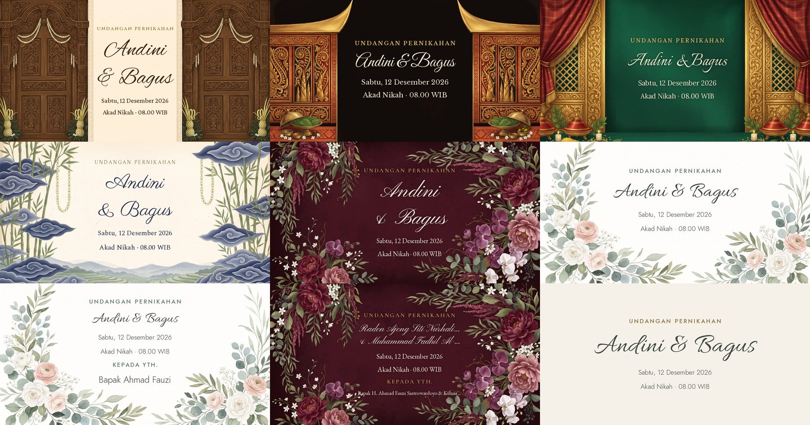

# Phase 4 report: Distribution

Branch `feat/distribution`. Commits:

| Commit | What |
|---|---|
| `2bbc7de` feat(links) | Clean `/<slug>/<code>` guest links, names from the guest list |
| `56d3165` feat(og) | Painted link previews for every invitation link |
| `d5244a6` feat(blast) | Guest import, WhatsApp templates, send queue |
| `f49a373` feat(tracking) | Which guests opened their personal link |
| `d2df02d` test(og) | Pin `FRONTEND_URL` in the OG tests |
| `d517519` feat(catalog) | Preview loops, `/tema/:id`, "Pakai tema ini" |
| `216f79f` feat(seo) | robots, sitemap, noindex, prerendered theme pages, funnel |
| *(this commit)* test(visual) + docs | `distribution.spec.js`, this report |

## Verification

| Check | Result |
|---|---|
| Backend tests | **174 passed** (`manage.py test apps`) |
| Unit tests (node) | **17 passed** (`npm run test:unit`): WhatsApp normaliser (same cases as the backend), import parsing, templates |
| `make check` | Theme registry OK: 6 themes (6 active), OG assets, crawler copies, preview files |
| Visual suite | See [Visual suite runs](#visual-suite-runs) |
| nginx | Production template passes `nginx -t` on nginx 1.25 and was exercised against a production build with a stub backend (results below) |
| Production build | Passes; guest-facing bundle grew about 0.6 KB gzipped (below) |

### Guest-facing bundle

| Chunk | Before Phase 4 (`05d53a5`) | Now | Why |
|---|---|---|---|
| `InvitationPage` | 8.46 KB (3.03 gz) | 9.34 KB (3.37 gz) | guest context, open beacon, `?variant=`, robots meta |
| `PackTheme` | 44.31 KB (13.72 gz) | 44.42 KB (13.81 gz) | UTM on the footer link |
| Main `index` | 168.31 KB (55.21 gz) | 168.96 KB (55.42 gz) | new routes, `blast.*` copy |

The import, queue, template editor, theme pages and funnel load as lazy dashboard or marketing chunks (`SendQueuePage` 8.9 KB). None of them is on the invitation route.

## A · Link previews



Full size, personal link: [`docs/distribution/og-personal.jpg`](docs/distribution/og-personal.jpg).

**What the image shows**
- It's drawn with Pillow 10.3 + raqm on each pack's own painting (`og-template.jpg`, built from the desktop cover).
- Content: "UNDANGAN PERNIKAHAN", the names, the primary event's date, then the event with its time and zone (e.g. "Akad Nikah · 08.00 WIB").
- On a personal link it adds "KEPADA YTH." and the guest's name **from the guest list**.
- Size is 1200×630, 114–176 KB (limit 300 KB). It renders in 50–95 ms on first request, then is served from disk.

**Long names**
- Fitting goes: shrink, then two lines at " & ", then shrink further until the whole block fits the box height, then an ellipsis.
- Tests render six name pairs on every pack plus the generic fallback: long Javanese/Balinese names, apostrophes, diacritics, 200-character names and a missing groom.

**Fresh previews.** `/og/<slug>[/<code>]/<hash>.jpg` hashes everything drawn on the image plus the pack art's fingerprint and a layout version.
- Editing the names, date, time zone, theme or variant gives a new URL; editing the opening text doesn't. All of this is covered by tests.
- Old hashes redirect (302) to the current image.
- Images are served with `Cache-Control: public, max-age=31536000, immutable`.

**`?to=` is never used.** Rude and 10 KB `?to=` values were sent through `/<slug>`, `/<slug>/<code>`, `/share/<slug>/` and `/share/…&g=`. They never appear in a title or description, and never change the image URL. `/share/` still hands `?to=` to the app in its redirect for people, because the cover reads it.

**Drafts, expired and unknown invitations** get the generic DearGuest tags, a 404 status and no image.

**Crawler routing**
- One list, `shared/crawlers.txt`, generated into the nginx `map`, the Vite proxy and the backend.
- Crawlers asking for `/<slug>` or `/<slug>/<code>` get Django's tag page; people get the app.

Production nginx, tested with a production build and a stub backend:

| Request | Browser | WhatsApp |
|---|---|---|
| `/demo`, `/demo/63YR9R`, `/demo?to=X&g=1` | app, `X-Robots-Tag: noindex` | Django tag page |
| `/tema`, `/tema/sage` | prerendered page with its own title | same prerendered page |
| `/dashboard/x` | app, `noindex` | app |
| `/og/…`, `/share/…` | Django | Django |
| `/`, `/register` | app, indexable | app |

Crawl check on the dev stack (`python3 scripts/crawl_check.py http://localhost:5183 demo-taman-sage WNB9BU`):

```
WhatsApp  /demo-taman-sage/WNB9BU  → 200  X-Robots-Tag: noindex, nofollow
  og:title         Untuk Bapak Ahmad Fauzi · Undangan Pernikahan Andini & Bagus
  og:description   Halo, dengan penuh sukacita kami mengundang Anda ke pernikahan kami pada Sabtu, 12 Desember 2026.
  og:url           http://localhost:5183/demo-taman-sage/WNB9BU
  og:image         http://localhost:5183/og/demo-taman-sage/WNB9BU/208af093b78d41cb.jpg
  og:image:width   1200
  og:image:height  630
  twitter:card     summary_large_image
  robots           noindex, nofollow
  image            200 image/jpeg 1200x630 116 KB · cache: public, max-age=31536000, immutable
```

**Title and description per variant.** The description greeting is `share.greeting` (Halo / Assalamualaikum / Salam sejahtera / Salam damai):
- `og.title`: "Undangan Pernikahan {bride} & {groom}"
- `og.titleGuest`: "Untuk {guest} · Undangan Pernikahan {bride} & {groom}"
- `og.description`: "{greeting}, dengan penuh sukacita kami mengundang Anda ke pernikahan kami pada {date}." There's no address and no phone number.

**Marketing site.** `public/social/dearguest.jpg` is a strip of all six covers (`scripts/build_social_image.py`); `index.html` and the prerendered pages use it.

**Checking on a real phone**
- WhatsApp caches a preview per URL. The cleanest test is a link that has never been shared, e.g. a new guest's `/<slug>/<code>`.
- After editing the names, the *page* URL is unchanged, so WhatsApp may keep showing its cached card for that page. The image URL changes, so any fresh fetch shows the new card.

## B · Guest links (compatibility)

| Link | Behaviour | Test |
|---|---|---|
| `/<slug>` | unchanged | `test_og`, visual suite |
| `/<slug>?to=X` | unchanged: name on the cover only, never in the preview | `test_og` `?to=` test; browser check |
| `/<slug>?to=X&g=CODE` | rewritten to `/<slug>/CODE`, name from the list | browser check (Phase 4 commit 1) |
| `/<slug>/<code>` (any case) | name and pax limit from the list; unknown code = general invitation | `test_guest_links`, `distribution.spec.js` |
| `/share/<slug>/` (± query) | tags for crawlers, redirect for people (`&g=` goes to `/<slug>/CODE`) | `test_og` |
| Old 8-character hex codes | still resolve | `test_guest_links` |

## C · Import, templates, send queue

**Import** (Daftar Tamu → Impor Tamu): paste from Excel or Sheets, or pick a CSV.
- Accepts tabs, commas or semicolons, quotes, CRLF and a BOM.
- Columns are guessed from headers (nama, no hp, wa, grup, jumlah…) or from content (the phone-number column).
- The preview flags blank names, invalid numbers, duplicate numbers and duplicate names. Nothing is saved until "Simpan".
- The server applies the same rules again (`guest_import.py`), at most 1000 rows per import.

**Templates** (`/dashboard/:slug/kirim` → Template pesan):
- `Invitation.wa_templates` stores only the couple's edits. A blank or default template means "use the default", so defaults can improve later.
- Variables: `{nama} {link} {pasangan} {tanggal} {acara}`. Unknown ones (`{nma}`) are flagged before sending.
- Greetings are reused from `copy.json`, and there's no scripture. `{salam}` is "Dengan hormat," (umum), "Assalamualaikum Wr. Wb." (islam, from the existing `invite.text`), "Salam sejahtera" (kristen) or "Salam damai" (katolik). `{greeting}` is `share.greeting`.

Defaults in full:

```
FORMAL
{salam}

Kepada Yth.
{nama}

Tanpa mengurangi rasa hormat, perkenankan kami mengundang Bapak/Ibu/Saudara/i untuk menghadiri acara pernikahan kami:

{pasangan}
{acara}: {tanggal}

Informasi lengkap dan konfirmasi kehadiran ada di undangan berikut:
{link}

Merupakan suatu kehormatan dan kebahagiaan bagi kami apabila Bapak/Ibu/Saudara/i berkenan hadir dan memberikan doa restu.

Terima kasih.
Kami yang berbahagia,
{pasangan}

SANTAI
{greeting} {nama}!

Kami mau berbagi kabar bahagia: kami akan menikah 🤍
{pasangan}
{acara}: {tanggal}

Undangan lengkapnya ada di sini, sekalian isi konfirmasi kehadirannya ya:
{link}

Ditunggu kehadiran dan doanya. Terima kasih!

GRUP (no guest name; the general link)
{salam}

Dengan penuh sukacita kami mengundang Bapak/Ibu/Saudara/i untuk hadir di pernikahan kami:

{pasangan}
{acara}: {tanggal}

Undangan lengkap:
{link}

Mohon maaf kami hanya dapat mengundang melalui pesan ini. Terima kasih atas doa dan kehadirannya.

{pasangan}
```

`{tanggal}` is e.g. "Sabtu, 12 Desember 2026, 08.00 WIB", in the event's own zone.

**Send queue** (`/dashboard/:slug/kirim`, mobile first):
- One guest at a time. "Kirim via WhatsApp" opens a `wa.me` deep link with the message.
- Coming back to the page (`visibilitychange`) marks the guest sent, with "Batalkan" to undo.
- Also: Salin pesan, Lewati, Tandai terkirim, filters by group and sent status, and a group message. Nothing is sent automatically.
- The guest list's own "Kirim" button uses the same template and also marks the guest sent.

## D · Open tracking

`POST /api/invitations/<slug>/guest/<code>/open/` is sent once when a personal link loads, and never on the editor preview.
- **Ignored:** crawlers (so WhatsApp's own preview fetch doesn't count), the couple and staff, and repeats within 30 minutes.
- **Stored:** `first_opened_at`, `last_opened_at`, `open_count`. Nothing else: no IP, device, location or fingerprint. The per-IP rate limit lives only in the cache.
- **Guest list:** counts for Total / Terkirim / Dibuka / Sudah RSVP / Sudah hadir; "dibuka N×" per guest; filters including **"Terkirim tapi belum dibuka"**.
- In development, React StrictMode sends the beacon twice. Production sends one, and the 30-minute dedupe absorbs it either way.

> **Privacy policy: a line is needed (not written by me).** The policy should say that when a guest opens their personal invitation link, DearGuest records the time and how often it was opened, and shows this to the couple who sent it. No IP address, device or location is stored.

## E · Catalogue

**Capture** (`sh frontend/scripts/capture-docker.sh [ids]`, needs the dev stack):
- Uses the Playwright image plus ffmpeg, built once as `dearguest-capture:1.61.1`.
- Records each active theme's real demo: a 720×1560 WebP still, and a 6-second 390×844 loop (cover → open → scroll) in VP9 WebM and H.264 MP4. The CRF goes up until each file is ≤ 1.5 MB.

| Theme | WebP | WebM | MP4 |
|---|---|---|---|
| javanese | 166 KB | 193 KB | 173 KB |
| minang | 122 KB | 196 KB | 160 KB |
| bugis | 115 KB | 173 KB | 143 KB |
| sunda | 83 KB | 155 KB | 133 KB |
| floral | 108 KB | 193 KB | 163 KB |
| sage | 69 KB | 134 KB | 117 KB |

**`/tema` and landing cards**
- The loop plays on hover, or on touch screens while the card is ≥ 60 % in view; never with reduced motion.
- The video source is attached on the first play. The visual suite caught WebKit fetching every `<source>` despite `preload="none"`, so this is fixed.

**`/tema/:id`**
- The demo runs in a phone frame, with a copy-variant toggle.
- `?variant=` is honoured **only for demo invitations**. The demo's own greeting gives way to the variant's, and ceremony events take the variant's type (akad → pemberkatan / sakramen). Covered by tests.
- "Pakai tema ini" goes to `/register?theme=<id>` (or `/onboarding?theme=` when logged in), and onboarding preselects the theme.

**Also**
- The landing page's theme blurb is now built from the registry; it listed themes that no longer exist.
- The free-tier footer link carries `utm_source=invitation&utm_medium=watermark&utm_campaign=<hash of slug>`, with no names.
- `make check` verifies each `previewVideo` exists and stays under 1.5 MB. Re-run the capture after adding a pack.

## F · Search engines and funnel

**What crawlers see**
- **Prerendered marketing pages:** `dist/tema/index.html` and `dist/tema/<id>/index.html`, each with its own title, description, canonical, OG tags and a `<noscript>` summary. A crawler without JavaScript now gets "Taman Sage · Tema Undangan Pernikahan DearGuest" instead of the generic shell.
- **`sitemap.xml`:** `/`, `/tema` and each theme page.
- **`robots.txt`:** disallows `/dashboard`, `/my`, `/onboarding` and `/api/`. I left `/og/` and `/share/` crawlable on purpose, because some preview bots (e.g. Twitterbot) honour robots.txt for card images. Both send `noindex` themselves.
- **`noindex`:** nginx sends `X-Robots-Tag: noindex, nofollow` for everything except the marketing pages and public files. Invitations also add a runtime robots meta tag.
- **HTML caching:** all HTML is served with `Cache-Control: no-cache`.

**Funnel**
- **Data:** `FunnelEvent(step, utm_source, utm_medium, utm_campaign, week)`, with no user, IP or session, so steps can only be counted, not joined into one person's path.
- **Steps:**
  - `visit`: at most one per browser session, from the landing and `/tema` pages, with bots dropped;
  - `register` and `onboarded`: they carry the visit's UTM;
  - `checkout` and `paid`: exist in the model, but nothing emits them until Phase 3.
- **Admin** (Funnel (per minggu)): weeks × steps for the last 12 weeks, filterable by source.

## Phase 3 (payments) deferrals

- `entitlements.py` is a placeholder: `has_feature()` allows `personalised_preview`, `wa_blast`, `guest_import` and `open_tracking` for everyone. Phase 3 fills in the tier table; callers don't change.
- Footer credit on paid invitations is still the existing `watermark` flag. The rule per tier is for Phase 3.
- The funnel steps `checkout` and `paid` need Phase 3 to emit them.
- There's no `/harga` page. The landing page's pricing claims are untouched; Phase 3 rebuilds them from product data.

## Known gaps and follow-ups

1. **Reserved slugs.** Nothing stops a couple choosing `tema`, `dashboard`, `register` etc. as their slug. The crawler view handles those names safely, but slug validation should reject them (add a list next to `SITE_PATHS` in `share_views.py`).
2. **Brand spelling.** New copy uses "DearGuest"; `index.html`'s title and the footer still say "Dear Guest". Pick one.
3. **`FRONTEND_URL` must be the real public origin in production.** Preview images and `og:url` are built on it.
4. **New packs need an `og` block and a capture run.** The other session's packs (Pampas Kraft, Gorga Ulos, Wisteria Lila, Bali) were built on this branch, so they have OG assets. Their registry entries don't have `previewVideo` yet; the gallery shows their still until `capture-docker.sh <id>` is run.
5. **Group messages aren't tracked per person**, by design (one general link).
6. **The queue's "sent" is the couple's word.** WhatsApp gives no delivery receipt for deep links; the copy says "ditandai terkirim".
7. **WhatsApp's per-URL preview cache** can keep an old card for a link that was shared before an edit (see "Checking on a real phone").

## Visual suite runs

New spec: `frontend/tests/visual/packs/distribution.spec.js`, 6 tests at 360 and 1440 on Chromium and WebKit:
- a personal link shows the name from the list, sends one open beacon and sets `noindex`;
- import: paste, mapping, preview flags, saved rows;
- guest list: sent and opened counts, the "Terkirim tapi belum dibuka" filter;
- send queue: `wa.me` link, back marks sent, undo, template typo, "Pakai untuk kirim";
- `/tema`: no video requested before hover;
- `/tema/:id`: variant toggle and "Pakai tema ini".

**The machine was not idle for these runs.** Another Claude session was building the Bali pack, and the load average was 8–22 throughout. Results as they are:

| Run | Passed | Failed | Notes |
|---|---|---|---|
| 1 | 257 | 7 | 6 × RSVP "Jawaban diperbarui", 1 × islam variant (webkit-1440, timeout) |
| 2 | 259 | 5 | javanese "every section" (chromium-390), bugis "no horizontal scroll" (webkit-390), maps × 2 and RSVP (webkit, 90 s timeouts) |
| Isolated re-runs | all | 0 | the 5 run-2 failures re-run alone: all pass; the maps test passes twice more on its own |

- **RSVP "Jawaban diperbarui":** the RSVP section's height rounds to 917 or 918 px between runs, which shifts the card by one pixel. The baselines were regenerated in this commit. The real fix is to make that section's height a whole number in the stylesheet; I've left it as a follow-up because it's Phase 2 CSS.
- **Maps "load only when asked" (WebKit):** this test also timed out under load in the Phase 2 runs, before any of this work.

**Recommended:** run `sh frontend/scripts/visual-docker.sh` twice on an idle machine before release, to get the clean double pass the project rules require.
